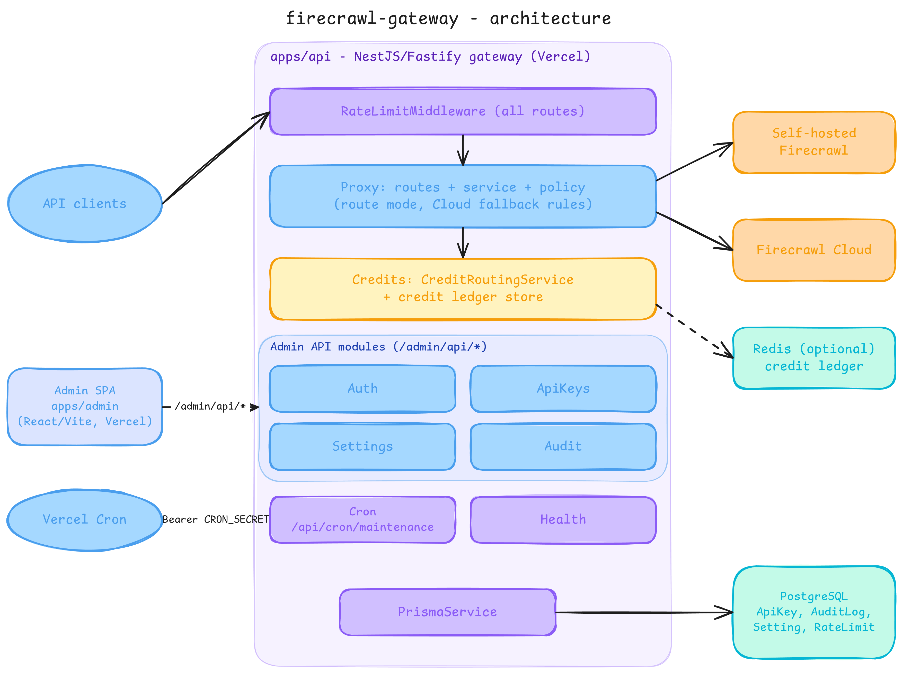

# Firecrawl Gateway

Firecrawl Gateway is an independently deployed gateway for operators who use Firecrawl Cloud, a self-hosted Firecrawl run from this repository's Docker Compose stack, or both. It provides one API boundary for compatible Firecrawl requests, routing controls, global virtual API keys, and an operator dashboard for settings and audit data.

This repository is a separate gateway application, not Firecrawl or PostgreSQL, and claims no official affiliation. It ships a Docker Compose stack in [`deploy/firecrawl`](deploy/firecrawl/docker-compose.yml) for self-hosting Firecrawl, but does not host PostgreSQL or Firecrawl Cloud. Upstream availability, feature compatibility, account access, and billing for Cloud and PostgreSQL remain the responsibility of those external services.

## Why this exists

Keep Firecrawl-compatible clients pointed at one gateway origin while deciding where eligible work runs: the self-hosted Firecrawl from `deploy/firecrawl`, Firecrawl Cloud, or a policy-controlled fallback. It issues `fc_`-prefixed virtual API keys, lets the single administrator configure Cloud keys and routing from a dashboard, and records outcomes in PostgreSQL-backed audit data. It is not a promise of full upstream feature parity: Cloud-managed requests still need Cloud, and sensitive or private requests face stricter fallback rules.

## Architecture

The Bun-workspace Turborepo contains two independently deployable apps:

- `apps/api` — a native NestJS API on the Fastify adapter. It authenticates virtual API keys, applies route policy, proxies `/v1/*` and `/v2/*`, and exposes health, readiness, administration, and maintenance routes.
- `apps/admin` — a root-hosted React/Vite admin SPA. It calls authenticated `/admin/api/*` endpoints on the API and does not run under an `/admin` URL prefix.

The gateway calls the self-hosted Firecrawl (this repository's Docker Compose stack) directly at `FIRECRAWL_SELF_HOSTED_URL`, which defaults to `http://127.0.0.1:3002`; it is not an admin setting. Cloud API keys are encrypted in PostgreSQL. PostgreSQL is also the source for global settings, API keys, audit logs, and shared rate-limit state; the repository does not add a file-based audit store.

## Routing and operational boundaries

The route mode is decided only by the `default_route_mode` admin setting; clients cannot override it per request (the `x-firecrawl-route-mode` header and `?routeMode=` query are ignored). It can be one of:

- `self-hosted-first` — use the self-hosted Firecrawl first and fall back to Cloud for eligible requests.
- `self-hosted-only` — never send requests to Cloud; Cloud-required requests are rejected.
- `cloud-first` — use Cloud first and fall back to self-hosted when an eligible, non-Cloud-required request cannot use the configured Cloud credit pool.
- `cloud-only` — use Cloud exclusively.
- `hybrid` — use the Cloud-role API keys first; when their credit runs out, use the self-hosted Firecrawl; when self-hosted also fails, use the Fallback-role API keys. A request that requires Cloud skips self-hosted and goes to a Fallback key once the Cloud-role keys are out of credit. With no Cloud-role key, hybrid starts on self-hosted and backs up to the Fallback keys.

Each Cloud API key has a role, `cloud` (default) or `fallback`, set on the admin Cloud API Keys page. Roles only matter in `hybrid`; every other mode uses all keys as one pool.

Some paths and request options require Cloud-managed behavior, including examples such as agent, browser, monitor, research, and Fire-engine-backed actions. The gateway routes those requests to Cloud when possible and rejects them in `self-hosted-only` mode. Fallback is policy-controlled rather than a generic retry: the self-hosted-first path, and the hybrid path's fallback keys, do not take over when sensitive upstream headers or cookies, sensitive body headers, or private target URLs are present.

The API's security and runtime boundaries are deliberate:

- With authentication enabled, clients send a virtual API key as a Bearer token. Plaintext is returned only when a key is created; store it securely.
- The single administrator is configured with `ADMIN_EMAIL` and `ADMIN_PASSWORD`; those credentials are not stored in PostgreSQL. Admin sessions use signed, HTTP-only, `SameSite=Lax` cookies that expire after 30 days and stop being valid when `ADMIN_PASSWORD` or `SESSION_SECRET` changes; the admin and API must therefore share a site (the documented single-origin deployment does). Logging out clears the cookie in that browser only. `SESSION_SECURE` overrides whether the cookie is `Secure` (default: on in production). Request `cookie` headers are never forwarded upstream.
- A virtual API key can optionally have an expiry, a per-minute rate limit, and a monthly request quota (calendar month, UTC), set when it is created or later from the admin Virtual API Keys page. An expired key is rejected with 401 and a key over its rate limit or quota with 429, all before any upstream call. The quota counts every authenticated request that was not already rejected by the rate limit, including requests the upstream later fails, and sends `x-quota-limit`, `x-quota-remaining`, `x-quota-reset` and `retry-after` when exhausted. Counting is approximate: pending counts are written to PostgreSQL every few seconds and on shutdown, and in the rare case a write is committed but its acknowledgement is lost the same requests can be counted twice. The same fixed-window counting means a write that lands just after a window ends can count toward the next window. Keys without either keep behaving exactly as before. The per-key limit uses the same approximate counting as the per-IP limit (counted in memory and flushed to PostgreSQL every few seconds), so it can be exceeded slightly across instances.
- Revoking a key or changing its limits takes effect immediately on the instance that handled the change; another instance can keep using its cached view of the key for up to 30 seconds.
- An optional in-memory response cache (`RESPONSE_CACHE_TTL_SECONDS`, off by default) can answer repeated plain `scrape` requests that would use Firecrawl Cloud. Firecrawl Cloud bills a scrape served from its own cache like any other (1 credit per page), so a gateway hit is the only way to avoid that charge. Entries are private to the virtual API key, never created for requests with `actions`, `headers`, a `profile`, `changeTracking`, `lockdown`, `minAge`, `zeroDataRetention`, `storeInCache: false`, sensitive headers, or private URLs, and only a successful (`success: true`) 200 response under 2 MB is stored. A request can opt out with `Cache-Control: no-cache` or `maxAge: 0`, and `maxAge` narrows (never extends) how old an entry it accepts. Hits are answered with `x-hybrid-firecrawl-cache: hit` and appear in the audit log with backend `cache`. The cache lives in one API instance's memory (a restart empties it), is bounded by `RESPONSE_CACHE_MAX_BYTES`, and serves data up to the TTL old, so choose a TTL the pages you scrape can tolerate. Self-hosted scrapes have no credits to save and are never cached.
- Optional Telegram alerts (`TELEGRAM_BOT_TOKEN` and `TELEGRAM_CHAT_ID`, both required) notify you when the estimated remaining Cloud credits fall below `ALERT_CREDITS_LOW_THRESHOLD`, when `ALERT_FALLBACK_RATIO_PERCENT` of recent requests used a fallback, or when the self-hosted circuit breaker is open. Each rule alerts once, repeats at most hourly while it keeps firing, and sends one "resolved" message after it has stayed clean for three checks. Messages contain only aggregate numbers and are sent to `api.telegram.org`; the credit figure is an estimate read from memory.
- `ADMIN_ORIGIN` and `API_ORIGIN` should be exact deployed origins for credentialed CORS; do not use `*` for this setup.
- Request bodies are inspected and forwarded as UTF-8 JSON. Binary uploads and Latin-1 text can be corrupted in transit, so this gateway is not a general binary proxy.
- A circuit breaker protects the self-hosted backend: after `SELF_HOSTED_BREAKER_FAILURE_THRESHOLD` consecutive failures (connection errors, timeouts, or 502/503/504; 5 by default, 0 disables it) self-hosted calls fail fast for `SELF_HOSTED_BREAKER_COOLDOWN_MS` (30 seconds by default) and then one probe request is let through. While it is open, the normal fallback policy applies unchanged: eligible requests go to Cloud, while requests with sensitive headers, cookies, or private target URLs get a 502 instead. State is per API instance. Request-specific failures (a generic 500 or an unsupported-feature 4xx) do not count.
- Upstream requests time out after `API_REQUEST_TIMEOUT_MS` (120 seconds by default). On SIGTERM or SIGINT the API stops accepting requests, drains in-flight ones, then closes the database and Redis connections; the gateway service's `stop_grace_period` in `deploy/gateway/docker-compose.yml` must stay above the timeout. The `maintenance` container calls the maintenance endpoint daily; it permanently removes audit entries older than 30 days.
- Prisma migrations are not applied during API startup. The single-admin cutover is destructive and requires explicit approval; see [`RELEASING.md`](RELEASING.md) and [`SELF_HOST.md`](SELF_HOST.md).

## Getting started

Follow [`QUICKSTART.md`](QUICKSTART.md) for local development and the Docker/GHCR deployment, and [`.env.example`](.env.example) for configuration. Prisma migrations are never applied by builds, the CI workflow, or API startup; the single-admin cutover is destructive, so review [`RELEASING.md`](RELEASING.md) before running `bun run db:migrate`.

## Documentation

- [`QUICKSTART.md`](QUICKSTART.md) — local development and running the API and admin
- [`SELF_HOST.md`](SELF_HOST.md) — self-hosted Firecrawl (Docker Compose), GHCR deployment, and PostgreSQL configuration
- [`apps/api/README.md`](apps/api/README.md) — API routes and Prisma operations
- [`docs/DESIGN.md`](docs/DESIGN.md) — admin UI design rules
- [`CONTRIBUTING.md`](CONTRIBUTING.md) — development and pull request guidance
- [`SUPPORT.md`](SUPPORT.md) — non-sensitive support and issue routing
- [`SECURITY.md`](SECURITY.md) — vulnerability reporting and secret hygiene
- [`RELEASING.md`](RELEASING.md) — version, tag, release, and deployment checklist
- [`CODE_OF_CONDUCT.md`](CODE_OF_CONDUCT.md) — community participation standards
- [`CHANGELOG.md`](CHANGELOG.md) — unreleased repository changes
